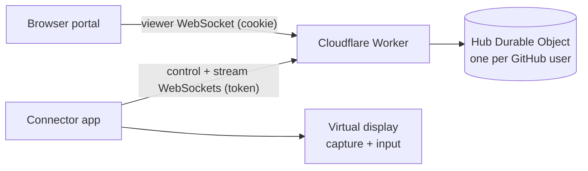

# doremote

Remote desktop for your own computers. A small connector app runs on each Mac or Windows PC, links to your GitHub account on **https://doremote.dev**, and shows up in the portal. Click it and the connector creates a virtual display at the resolution you picked, switches the other screens off so every window lands on it, and streams it to your browser; your mouse and keyboard drive the machine.



| Part | Path | Stack |
| --- | --- | --- |
| Portal + relay | `worker/` | Cloudflare Worker, Durable Objects (hibernatable WebSockets), static assets, GitHub OAuth |
| Connector | `connector/` | Go; macOS: CGVirtualDisplay + ScreenCaptureKit + CGEvent (cgo); Windows: Parsec Virtual Display Driver + CCD display API + GDI capture + SendInput |
| Packaging | `packaging/`, `.github/workflows/` | universal `doremote.app`, `doremote.exe` with icon/manifest, GitHub release on tag |

## Using it

**macOS (13+)**: download `doremote-macos.zip` from the latest release, unzip, move `doremote.app` to Applications, right-click → **Open** the first time (it is ad-hoc signed, not notarized). It lives in the menu bar. Grant **Screen Recording** and **Accessibility** when asked (or via the menu's ⚠ item), then quit and reopen it.

**Windows 10/11**: download `doremote-windows-amd64.exe` (`-arm64` for ARM PCs) and run it; SmartScreen may need **More info → Run anyway**. It lives in the notification area. The first time, choose **Install the virtual display driver…** (installs [Parsec VDD](https://github.com/nomi-san/parsec-vdd), needs admin).

On first launch the browser opens doremote.dev: sign in with GitHub and click **Connect**. The computer then appears in the portal whenever the app is running, for any browser signed in with the same GitHub account. Set its resolution on the portal card, then **Connect**.

Menu: status, **Open doremote**, **Turn off other screens during sessions** (on by default; off keeps local screens on), **Sign in again…** (re-link to another account), **Show log**, **Quit**.

Command-line flags (handy for development): `-cli` (no tray, logs to the terminal), `-server http://localhost:8787`, `-name`, `-logout`, `-selftest [-no-isolate]` (creates a virtual display, isolates, captures a frame to `doremote-selftest.jpg`, injects input, restores), `-version`.

### Display safety

Switching screens off is undone when the session ends. If the connector dies mid-session, a guard process it spawned restores the displays immediately, and the next start re-checks a state file (`isolation-state.json` in the config directory). On macOS the display reconfiguration runs in short-lived helper processes because a process that reconfigures displays stops seeing later display changes.

## Deploying the portal

1. Create a GitHub OAuth app (GitHub → Settings → Developer settings → OAuth Apps): homepage `https://doremote.dev`, callback `https://doremote.dev/auth/callback`.
2. In `worker/`:
   ```sh
   npm install
   npx wrangler secret put GITHUB_CLIENT_ID
   npx wrangler secret put GITHUB_CLIENT_SECRET
   npx wrangler secret put SESSION_SECRET   # e.g. `openssl rand -hex 32`
   npx wrangler deploy                       # binds the doremote.dev custom domain
   ```
Rotating `SESSION_SECRET` signs everyone out and unlinks every connector.

Local development: copy `worker/.dev.vars.example` to `.dev.vars` (use a second OAuth app with callback `http://localhost:8787/auth/callback`), run `npm run dev`, then `go run ./connector -cli -server http://localhost:8787`.

## Releasing

Push a tag: `git tag v0.1.0 && git push origin v0.1.0`. The **Release** workflow builds `doremote-macos.zip` (universal, on a macOS runner) and `doremote-windows-{amd64,arm64}.exe` (cross-compiled) and attaches them to a GitHub release. Build locally with `VERSION=0.1.0 packaging/macos/build.sh` and `VERSION=0.1.0 packaging/windows/build.sh` (outputs in `dist/`).

The **Windows self-test** workflow installs the Parsec driver on a GitHub Windows runner and runs `doremote -selftest` with and without isolation, uploading the captured frames.

## Protocol

- Pairing: the connector listens on `127.0.0.1:<port>` and opens `/connect?port&state&name&os`; after GitHub sign-in and approval the portal redirects to the loopback with a connector token (HS256 JWT bound to the user and a machine id). Removing the machine on the portal revokes it.
- Control socket `/api/connector/ws`: `hello` → hub; hub → `session {sid,width,height}` / `end {sid}`.
- Per-session stream `/api/connector/stream?sid=` paired by the hub with the viewer socket `/api/machines/:id/view`; messages relay verbatim.
- Frames: binary `u16 count` then per changed region `u16 x,y,w,h, u32 len, JPEG` (64 px tiles, merged per row; full frame when more than half changed), at most 30/s and 2 unacknowledged. Viewer input: JSON `move`, `button`, `wheel`, `key` (DOM `code`), `release`, `ack`.

## Limitations

- JPEG tiles, not a video codec: busy screens can use 10–20+ Mbps, all relayed through a Durable Object.
- The macOS app is not notarized; without a Developer ID, macOS asks for Screen Recording/Accessibility again after each update.
- Windows needs the Parsec Virtual Display Driver; the secure desktop (UAC prompts, lock screen) cannot be captured from a user-mode app.
- Windows support has been verified by cross-compilation, review and the CI self-test workflow, not yet on a physical Windows PC.
