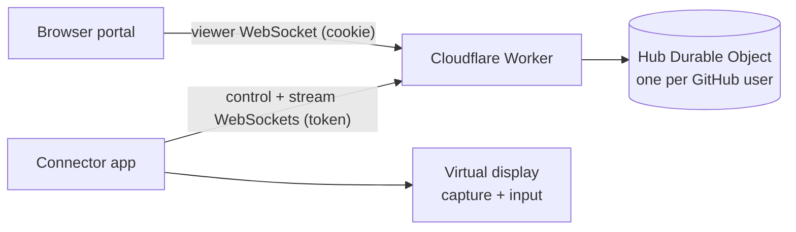

# doremote

Remote desktop for your own computers. A small connector app runs on each Mac or Windows PC, links to your GitHub account on **https://doremote.dev**, and shows up in the portal. Click it and the connector creates a virtual display at the resolution you picked, switches the other screens off so every window lands on it, and streams it to your browser; your mouse and keyboard drive the machine.



| Part | Path | Stack |
| --- | --- | --- |
| Portal + relay | `worker/` | Cloudflare Worker, Durable Objects (hibernatable WebSockets), static assets, GitHub OAuth |
| Connector | `connector/` | Go; macOS: CGVirtualDisplay + ScreenCaptureKit + CGEvent (cgo); Windows: Parsec Virtual Display Driver + CCD display API + GDI capture + SendInput |
| Packaging | `packaging/`, `.github/workflows/` | universal Developer ID signed `doremote.app`, `doremote.exe` with icon/manifest, GitHub release on every connector change to `main` |

## Using it

**macOS (13+)**: download `doremote-macos.zip` from the latest release, unzip, move `doremote.app` to Applications and open it. It lives in the menu bar. Grant **Screen Recording** and **Accessibility** when asked (or via the menu's ⚠ item), then quit and reopen it. The app is Developer ID signed, so the grants survive updates.

**Windows 10/11**: download `doremote-windows-amd64.exe` (`-arm64` for ARM PCs) and run it; SmartScreen may need **More info → Run anyway**. It lives in the notification area. The first time, choose **Install the virtual display driver…** (installs [Parsec VDD](https://github.com/nomi-san/parsec-vdd), needs admin).

On first launch the browser opens doremote.dev: sign in with GitHub and click **Connect**. The computer then appears in the portal whenever the app is running, for any browser signed in with the same GitHub account. Set its resolution on the portal card, then **Connect**.

Menu: status, **Open doremote**, **Turn off other screens during sessions** (on by default; off keeps local screens on), **Sign in again…** (re-link to another account), **Show log**, the update state (click to check now), **Quit**.

Command-line flags (handy for development): `-cli` (no tray, logs to the terminal), `-server http://localhost:8787`, `-name`, `-logout`, `-selftest [-no-isolate]` (creates a virtual display, isolates, captures a frame to `doremote-selftest.jpg`, injects input, restores), `-update-feed` (releases URL to update from), `-version`.

### Updates

The menu-bar/tray app checks the latest GitHub release a minute after start and hourly. A newer version is downloaded next to the installed copy, verified, and installed once no remote session is running: the app swaps itself out, starts the new version and quits. Verification, all of which must pass:

- `update.json` (version and SHA-256 of each download) must carry a valid Ed25519 signature (`update.json.sig`) from the key in `connector/update.go`. Its private key exists only as the `UPDATE_SIGNING_KEY` secret of the `release` environment, so tampered release assets are rejected.
- The version must be higher than the running one, so an old signed manifest can't roll a machine back.
- The download must match the signed SHA-256.
- macOS only: the new `doremote.app` must satisfy `anchor apple generic and identifier "dev.doremote.connector" and certificate leaf[subject.OU] = "8VSK2S4PQ7"`.

Development builds (`0.0.0-dev`) and `-cli` never update. On macOS the bundle's folder must be writable (Applications is, for admin users), and an app that macOS runs from a translocated read-only copy reports that it must be moved to Applications first.

### Display safety

Switching screens off is undone when the session ends. If the connector dies mid-session, a guard process it spawned restores the displays immediately, and the next start re-checks a state file (`isolation-state.json` in the config directory). On macOS the display reconfiguration runs in short-lived helper processes because a process that reconfigures displays stops seeing later display changes.

## Deploying the portal

1. Create a GitHub OAuth app (GitHub → Settings → Developer settings → OAuth Apps): homepage `https://doremote.dev`, callback `https://doremote.dev/auth/callback`.
2. In `worker/`:
   ```sh
   npm install
   npx wrangler secret put GITHUB_CLIENT_ID
   npx wrangler secret put GITHUB_CLIENT_SECRET
   npx wrangler secret put SESSION_SECRET   # e.g. `openssl rand -hex 32`
   npx wrangler deploy                       # binds the doremote.dev custom domain
   ```
Rotating `SESSION_SECRET` signs everyone out and unlinks every connector.

Local development: copy `worker/.dev.vars.example` to `.dev.vars` (use a second OAuth app with callback `http://localhost:8787/auth/callback`), run `npm run dev`, then `go run ./connector -cli -server http://localhost:8787`.

## Releasing

Every push to `main` that touches `connector/`, `packaging/` or the workflow runs **Release**:

1. Picks the next patch version after the highest `v*` tag. Run it by hand (Actions → Release → Run workflow) to bump minor or major instead.
2. Builds `doremote-macos.zip` on a macOS runner: universal, signed with the Developer ID identity from a temporary keychain, hardened runtime, notarized and stapled.
3. Cross-compiles `doremote-windows-{amd64,arm64}.exe`.
4. Writes and signs `update.json`, checks the signature against the key the connectors trust, and publishes release `vX.Y.Z` with all five files.

Releases run one at a time. Several merges in a row collapse into one release of the latest commit.

The secrets live in the `release` environment, which only `main` can deploy to:

| Name | Kind | Contents |
| --- | --- | --- |
| `MACOS_CERT_P12`, `MACOS_CERT_PASSWORD` | secret | Developer ID Application identity as base64 `.p12` |
| `APPLE_APP_PASSWORD` | secret | app-specific password for notarization; without it releases are signed but not notarized |
| `UPDATE_SIGNING_KEY` | secret | Ed25519 private key (PEM) |
| `APPLE_ID` | variable | Apple ID that notarizes |

Rulesets block force-pushes to and deletion of `main`, and moving or deleting `v*` tags. Anyone who can push to `main` can ship code to every connector.

Build locally with `VERSION=0.1.0 packaging/macos/build.sh` and `VERSION=0.1.0 packaging/windows/build.sh` (outputs in `dist/`). The macOS script signs with the first Developer ID Application identity in your keychain (`SIGN_IDENTITY=-` for ad-hoc) and notarizes when `NOTARY_PROFILE` or `APPLE_ID` + `APPLE_APP_PASSWORD` is set.

The **Windows self-test** workflow installs the Parsec driver on a GitHub Windows runner and runs `doremote -selftest` with and without isolation, uploading the captured frames.

## Protocol

- Pairing: the connector listens on `127.0.0.1:<port>` and opens `/connect?port&state&name&os`; after GitHub sign-in and approval the portal redirects to the loopback with a connector token (HS256 JWT bound to the user and a machine id). Removing the machine on the portal revokes it.
- Control socket `/api/connector/ws`: `hello` → hub; hub → `session {sid,width,height}` / `end {sid}`.
- Per-session stream `/api/connector/stream?sid=` paired by the hub with the viewer socket `/api/machines/:id/view`; messages relay verbatim.
- Frames: binary `u16 count` then per changed region `u16 x,y,w,h, u32 len, JPEG` (64 px tiles, merged per row; full frame when more than half changed), at most 30/s and 2 unacknowledged. Viewer input: JSON `move`, `button`, `wheel`, `key` (DOM `code`), `release`, `ack`.

## Limitations

- JPEG tiles, not a video codec: busy screens can use 10–20+ Mbps, all relayed through a Durable Object.
- Windows builds are not Authenticode signed; SmartScreen warns on first download. Updates are verified by the signed manifest instead.
- Windows needs the Parsec Virtual Display Driver; the secure desktop (UAC prompts, lock screen) cannot be captured from a user-mode app.
- Windows is exercised by the self-test workflow on GitHub's Windows Server 2022 VMs (virtual display, isolation, capture, input, restore). It hasn't been run on a physical Windows PC or against the live portal yet.
